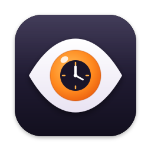

# AppAlibi [](https://github.com/pawisoon/AppAlibi/actions/workflows/build.yml)



AppAlibi is a Mac menu bar app that keeps a history of which apps used your camera, microphone and screen, and which ones asked for your files.

## Why?

### macOS doesn't remember

The green and orange dots tell you something is using the camera or microphone right now. Once they go away there's no record of what it was. AppAlibi keeps one.

### More than the dots

Besides the camera, microphone, screen recording and location, AppAlibi records which apps asked for protected folders and Full Disk Access, when an app was given administrator rights, and what AI assistants and coding agents were allowed to do.

### While you were away

AppAlibi knows when the screen was locked. If something used the camera, microphone or screen while you were away, it tells you when you come back.

### Summaries

Daily and weekly summaries show which apps used what, and for how long. History can be exported as CSV.

### Private

Everything stays on your Mac in a local database. AppAlibi makes no network requests.

## Getting Started

### Installation

Download the latest release from the [Releases page](https://github.com/pawisoon/AppAlibi/releases/latest), open the disk image and drag AppAlibi to Applications. Requires macOS 15 or later.

Releases are signed with a Developer ID and notarized by Apple.

### FAQ

There's a [FAQ here](FAQ.md).

### Building from Source

You need Xcode 26 and [XcodeGen](https://github.com/yonaskolb/XcodeGen).

```bash
xcodegen generate
open AppAlibi.xcodeproj
```

Run the `AppAlibi` scheme. Unit tests for the log parsers and the database:

```bash
swift test --package-path AlibiKit
```

### How It Works

AppAlibi follows the macOS unified log with `/usr/bin/log`. It reads the Control Center events behind the privacy dots, permission checks from `tccd`, screen locks from `loginwindow` and authorization grants from `authd`. The log messages aren't a public API, so a macOS update can change them; `alibi-probe` replays recent log history through the parsers to check they still work:

```bash
swift run --package-path AlibiKit alibi-probe 6
```

## Support

AppAlibi is free and open source. If you find it useful, you can [sponsor it on GitHub](https://github.com/sponsors/pawisoon), [buy me a coffee](https://buymeacoffee.com/pawisoon) or [support me on Suppi](https://suppi.pl/pawels).

## License

[MIT](LICENSE)
